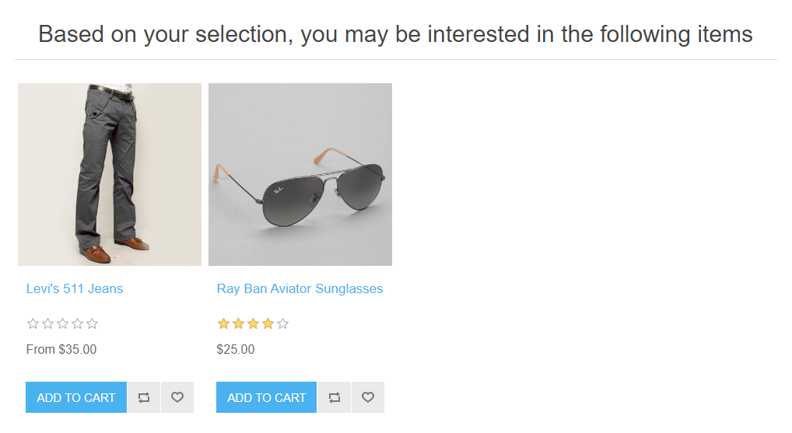
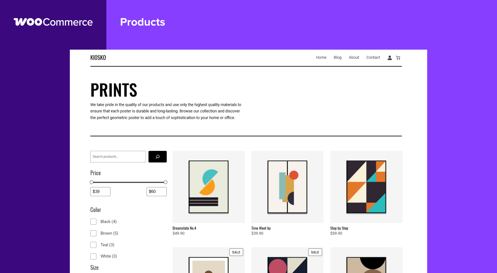
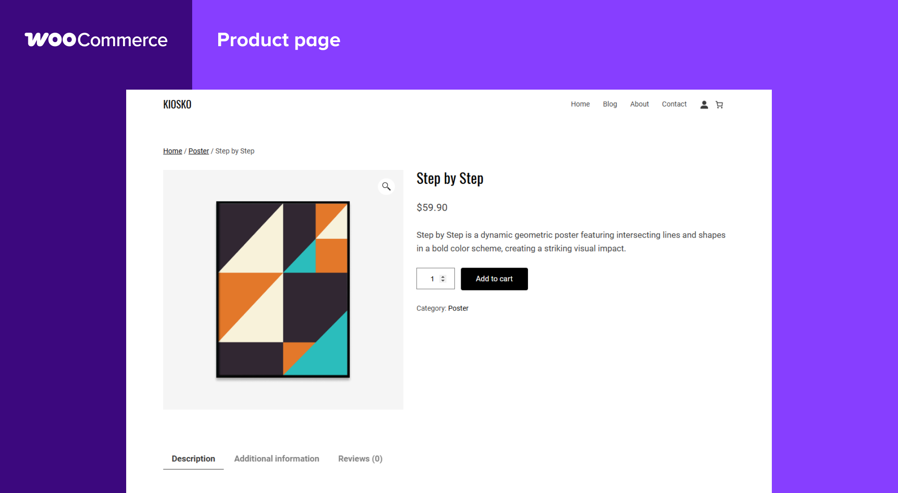
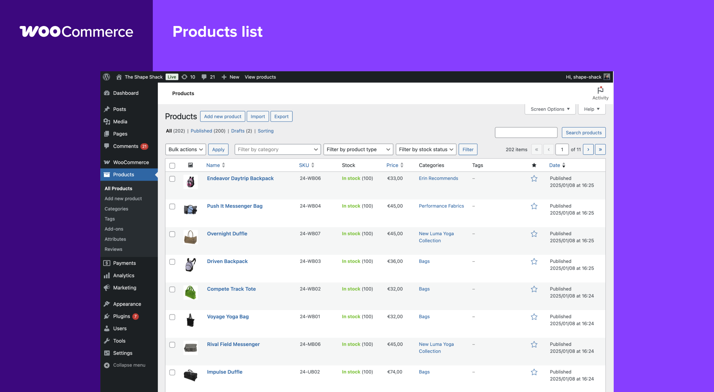
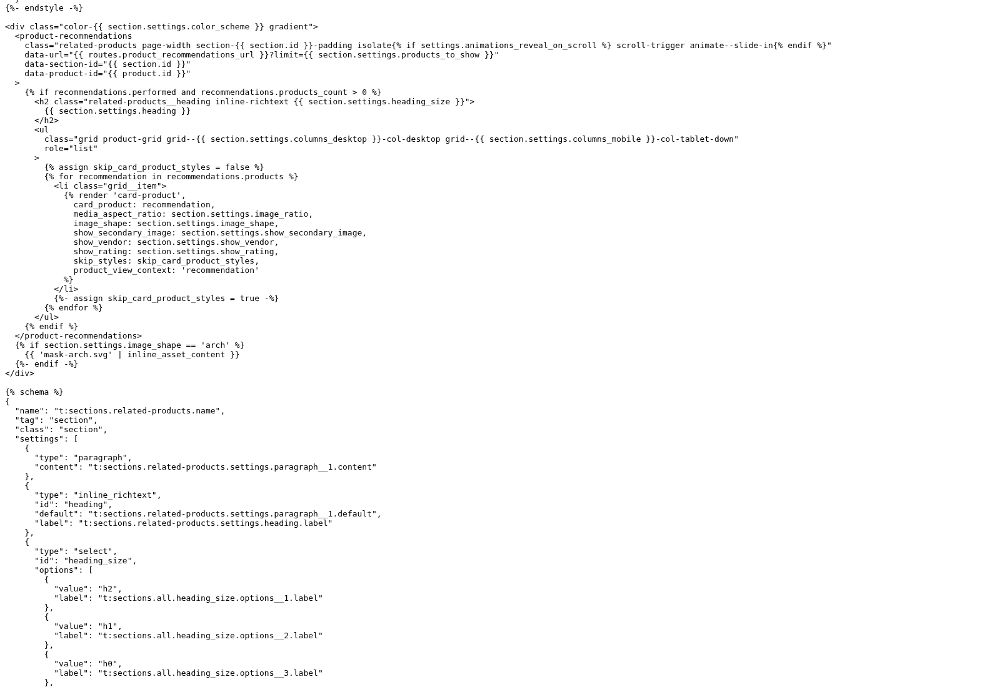
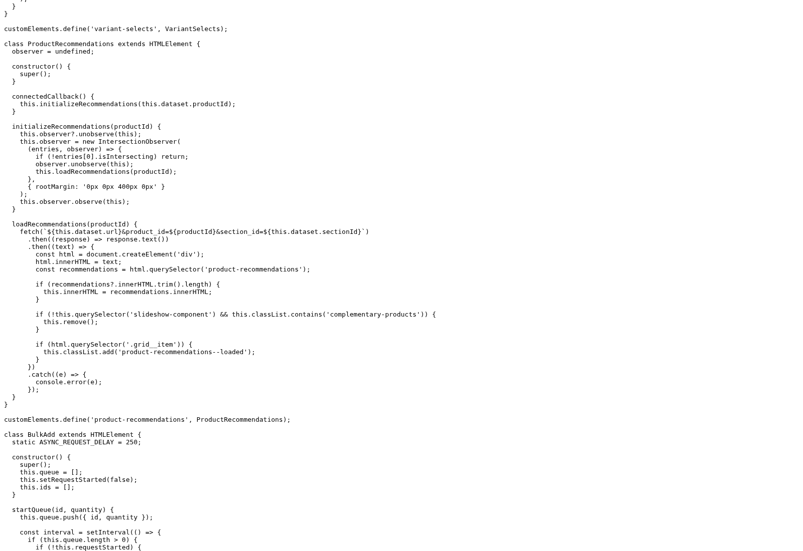
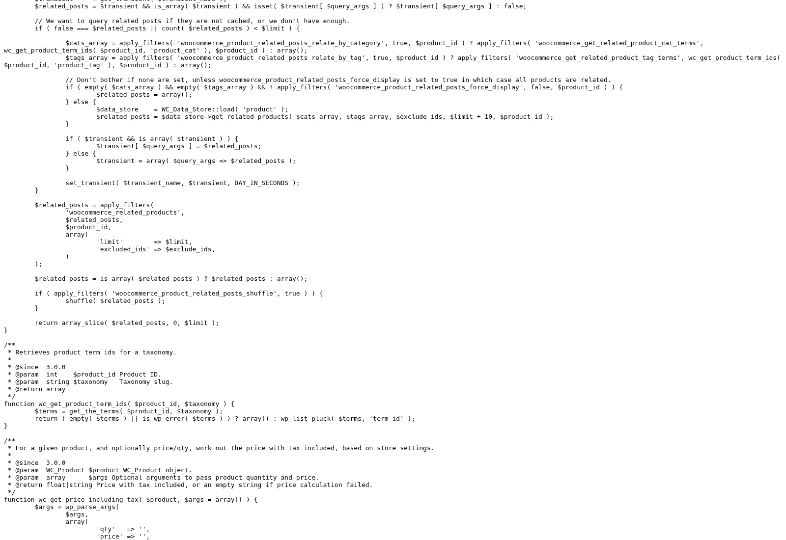

# Phụ lục minh chứng hình ảnh — Shopify Dawn, WooCommerce và nopCommerce

Bộ ảnh bổ sung cho báo cáo gợi ý sản phẩm theo hành vi. Ngày thu thập: 24/10/2026 (giờ Việt Nam, UTC+7).

## Phân loại và cách sử dụng

- **6 ảnh giao diện từ nguồn công bố chính thức:** 3 ảnh trong tài liệu nopCommerce và 3 ảnh giới thiệu của WooCommerce. Giữ nguyên byte của tệp gốc; không cắt, ghép, thêm nhãn hoặc thay nội dung. Khung màu/tên nền tảng trên ảnh WooCommerce đã có trong ảnh do nguồn công bố.
- **3 ảnh chụp mã nguồn:** chụp bằng Chromium/Playwright trực tiếp từ trang mã gốc do GitHub phục vụ, ở commit cố định. Đây là minh chứng kỹ thuật, không phải ảnh chụp cửa hàng. Không dựng lại giao diện hoặc thay đổi nội dung trang.
- Thời điểm thu thập không phải thời điểm ảnh giao diện gốc được chụp. Không suy ra phiên bản sản phẩm đang vận hành từ ngày tải ảnh. Commit nhận diện phiên bản tài liệu/tài nguyên, không tự xác định ngày chụp ảnh gốc.
- Không dùng ảnh giao diện để kết luận đã triển khai cá nhân hóa, học máy, tăng doanh thu hoặc phản ánh một tài khoản cụ thể.
- Trang demo/trợ giúp của các nền tảng và tệp ảnh giao diện Shopify đính kèm trong issue trả lỗi chặn truy cập 403 qua proxy. Vì vậy, bộ này **chưa có ảnh giao diện cửa hàng Shopify Dawn hoặc ảnh chụp demo trực tiếp trong phiên**. Lỗi truy cập của môi trường không chứng minh website ngừng hoạt động.
- Các ảnh minh họa nền tảng tham chiếu, không phải baseline hoặc sản phẩm do nhóm xây dựng. Mục 2.2 của báo cáo vẫn cần source baseline thực tế.

## Tải tài liệu

- [Phụ lục Word có ảnh và chú thích](PHU-LUC-MINH-CHUNG-HINH-ANH.docx)
- [Phụ lục PDF có ảnh và chú thích](PHU-LUC-MINH-CHUNG-HINH-ANH.pdf)
- [Metadata, nguồn và SHA-256 của từng ảnh](MANIFEST-HINH-ANH.json)
- [Nhật ký các lần truy cập bị chặn](NHAT-KY-TRUY-CAP.json)

## Danh mục và chú thích đề xuất

Số PL.1–PL.9 là số hình của phụ lục; điều chỉnh lại nếu chèn vào Chương 2. Nguồn ảnh phải đi cùng hình khi sử dụng.

### Hình PL.1. Related products trong tài liệu nopCommerce

**Loại:** Ảnh giao diện do tài liệu chính thức công bố. **Kích thước:** 1087 × 572 px.

**Chú thích đề xuất:** Khối Related products hiển thị thẻ sản phẩm, giá, đánh giá và nút thêm vào giỏ hàng.

**Nguồn:** nopSolutions / tài liệu nopCommerce. [Trang ngữ cảnh](https://github.com/nopSolutions/nopCommerce-Docs/blob/b428a1dfc94b72c6a45e3267360efd7e662c2853/en/running-your-store/promotional-tools/cross-sells-and-related-products.md); [tệp/trang gốc](https://raw.githubusercontent.com/nopSolutions/nopCommerce-Docs/b428a1dfc94b72c6a45e3267360efd7e662c2853/en/running-your-store/promotional-tools/_static/cross-sells-and-related-products/rel-product-on-the-prod-det-page.png).

**Ghi nhận:** 2026-10-24T23:13:06.993366+07:00. Với ảnh công bố, đây là thời gian tải tệp; ngày chụp ảnh gốc chưa xác định.

**Giới hạn:** Không xác định được thuật toán cá nhân hóa hoặc lịch sử người dùng từ ảnh; đây không phải ảnh demo trực tiếp chụp hôm nay.

**Vị trí đề xuất:** 2.1.1 — trường hợp nopCommerce.

**SHA-256:** `af0504a6416fa4b9d27d2d00f8ac719ac038ed6cc9638226f097e4e65a9b461d`.

### Hình PL.2. Cấu hình sản phẩm liên quan trong nopCommerce

**Loại:** Ảnh giao diện do tài liệu chính thức công bố. **Kích thước:** 1106 × 500 px.

**Chú thích đề xuất:** Bảng cấu hình các sản phẩm liên quan có thứ tự hiển thị và nút Add new related product.

**Nguồn:** nopSolutions / tài liệu nopCommerce. [Trang ngữ cảnh](https://github.com/nopSolutions/nopCommerce-Docs/blob/b428a1dfc94b72c6a45e3267360efd7e662c2853/en/running-your-store/promotional-tools/cross-sells-and-related-products.md); [tệp/trang gốc](https://raw.githubusercontent.com/nopSolutions/nopCommerce-Docs/b428a1dfc94b72c6a45e3267360efd7e662c2853/en/running-your-store/promotional-tools/_static/cross-sells-and-related-products/Related.png).

**Ghi nhận:** 2026-10-24T23:13:06.986574+07:00. Với ảnh công bố, đây là thời gian tải tệp; ngày chụp ảnh gốc chưa xác định.

**Giới hạn:** Minh chứng giao diện cấu hình quan hệ; không chứng minh quan hệ được tự động học từ dữ liệu hành vi.

**Vị trí đề xuất:** 2.1.1 — trường hợp nopCommerce.

**SHA-256:** `95a0c3b37d5105b44b2c475807ffa20e1e6cbad115ea160e3230051428dd0987`.

### Hình PL.3. Khối gợi ý bán kèm trong tài liệu nopCommerce

**Loại:** Ảnh giao diện do tài liệu chính thức công bố. **Kích thước:** 1018 × 557 px.

**Chú thích đề xuất:** Khu vực gợi ý bổ sung có tiêu đề Based on your selection, you may be interested in the following items.

**Nguồn:** nopSolutions / tài liệu nopCommerce. [Trang ngữ cảnh](https://github.com/nopSolutions/nopCommerce-Docs/blob/b428a1dfc94b72c6a45e3267360efd7e662c2853/en/running-your-store/promotional-tools/cross-sells-and-related-products.md); [tệp/trang gốc](https://raw.githubusercontent.com/nopSolutions/nopCommerce-Docs/b428a1dfc94b72c6a45e3267360efd7e662c2853/en/running-your-store/promotional-tools/_static/cross-sells-and-related-products/Cross-sells_on_checkout.png).

**Ghi nhận:** 2026-10-24T23:13:06.990771+07:00. Với ảnh công bố, đây là thời gian tải tệp; ngày chụp ảnh gốc chưa xác định.

**Giới hạn:** Dòng tiêu đề thể hiện ngữ cảnh bán kèm, chưa xác lập phương pháp cá nhân hóa. Vị trí tại checkout được mô tả trong tài liệu nguồn, không được suy ra chỉ từ phần ảnh này.

**Vị trí đề xuất:** 2.1.1 — trường hợp nopCommerce.

**SHA-256:** `98ec71cf5e8a36ac9dd876a3931b5e110b8cf808d7d0eea4f77f469c7a280f87`.

### Hình PL.4. Danh sách và bộ lọc sản phẩm WooCommerce

**Loại:** Ảnh giới thiệu chính thức kèm giao diện cửa hàng. **Kích thước:** 2000 × 1100 px.

**Chú thích đề xuất:** Ảnh công bố hiển thị danh sách sản phẩm và bộ lọc giá, màu trên giao diện cửa hàng KIOSKO.

**Nguồn:** WooCommerce contributors / tài nguyên công bố plugin. [Trang ngữ cảnh](https://github.com/woocommerce/woocommerce/blob/8881dc3f7ddbeb133c249b805807e208965f2b26/plugins/woocommerce/.wordpress-org/screenshot-3.png); [tệp/trang gốc](https://raw.githubusercontent.com/woocommerce/woocommerce/8881dc3f7ddbeb133c249b805807e208965f2b26/plugins/woocommerce/.wordpress-org/screenshot-3.png).

**Ghi nhận:** 2026-10-24T23:13:07.314409+07:00. Với ảnh công bố, đây là thời gian tải tệp; ngày chụp ảnh gốc chưa xác định.

**Giới hạn:** Minh họa tổ chức catalog và bộ lọc; ảnh không hiển thị kết quả gợi ý theo hành vi.

**Vị trí đề xuất:** 2.1.1 — trường hợp WooCommerce.

**SHA-256:** `f2e9c86bc7c07b715a9cb6d37acf66fa1513f2e7e24184e13996a32a5df02ba5`.

### Hình PL.5. Trang chi tiết sản phẩm WooCommerce

**Loại:** Ảnh giới thiệu chính thức kèm giao diện cửa hàng. **Kích thước:** 2000 × 1100 px.

**Chú thích đề xuất:** Ảnh công bố hiển thị hình sản phẩm, tên, giá, mô tả và nút Add to cart trên trang chi tiết.

**Nguồn:** WooCommerce contributors / tài nguyên công bố plugin. [Trang ngữ cảnh](https://github.com/woocommerce/woocommerce/blob/8881dc3f7ddbeb133c249b805807e208965f2b26/plugins/woocommerce/.wordpress-org/screenshot-4.png); [tệp/trang gốc](https://raw.githubusercontent.com/woocommerce/woocommerce/8881dc3f7ddbeb133c249b805807e208965f2b26/plugins/woocommerce/.wordpress-org/screenshot-4.png).

**Ghi nhận:** 2026-10-24T23:13:07.360397+07:00. Với ảnh công bố, đây là thời gian tải tệp; ngày chụp ảnh gốc chưa xác định.

**Giới hạn:** Ảnh chỉ minh họa ngữ cảnh trang sản phẩm; không dùng làm bằng chứng về thuật toán sản phẩm liên quan.

**Vị trí đề xuất:** 2.1.1 — trường hợp WooCommerce.

**SHA-256:** `fb7ee98da7daf96873430f7078b6e2e0abafc8a5f321ad520e8920c0c997704d`.

### Hình PL.6. Danh sách sản phẩm trong quản trị WooCommerce

**Loại:** Ảnh giới thiệu chính thức kèm giao diện quản trị. **Kích thước:** 2000 × 1100 px.

**Chú thích đề xuất:** Bảng sản phẩm có SKU, trạng thái tồn kho, giá, danh mục và thẻ.

**Nguồn:** WooCommerce contributors / tài nguyên công bố plugin. [Trang ngữ cảnh](https://github.com/woocommerce/woocommerce/blob/8881dc3f7ddbeb133c249b805807e208965f2b26/plugins/woocommerce/.wordpress-org/screenshot-2.png); [tệp/trang gốc](https://raw.githubusercontent.com/woocommerce/woocommerce/8881dc3f7ddbeb133c249b805807e208965f2b26/plugins/woocommerce/.wordpress-org/screenshot-2.png).

**Ghi nhận:** 2026-10-24T23:13:06.993989+07:00. Với ảnh công bố, đây là thời gian tải tệp; ngày chụp ảnh gốc chưa xác định.

**Giới hạn:** Đây là giao diện nền tảng tham chiếu, không phải giao diện baseline của nhóm. Không xác nhận cơ chế gợi ý từ ảnh này.

**Vị trí đề xuất:** 2.1.1 — trường hợp WooCommerce; minh họa đối tượng dữ liệu tham chiếu.

**SHA-256:** `5513f7aba5f734d91c4bbafd26468b27c9fa774b5cb662024cbdf9b4a818512b`.

### Hình PL.7. Mã giao diện Related products của Shopify Dawn

**Loại:** Ảnh chụp trình duyệt — trang mã nguồn gốc. **Kích thước:** 1600 × 1100 px.

**Chú thích đề xuất:** Ảnh chụp nội dung Liquid được GitHub phục vụ, có product-recommendations, địa chỉ dịch vụ và vòng lặp recommendations.products.

**Nguồn:** Shopify. [Trang ngữ cảnh](https://github.com/Shopify/dawn/blob/05222537f672cc0e8ae8aa3ac07808b9cfc34742/sections/related-products.liquid#L24-L43); [tệp/trang gốc](https://raw.githubusercontent.com/Shopify/dawn/05222537f672cc0e8ae8aa3ac07808b9cfc34742/sections/related-products.liquid).

**Ghi nhận:** 2026-10-24T23:16:47.117314+07:00. Với ảnh công bố, đây là thời gian tải tệp; ngày chụp ảnh gốc chưa xác định.

**Giới hạn:** Đây là minh chứng mã nguồn, không phải ảnh giao diện cửa hàng hoặc bằng chứng về thuật toán nội bộ của Shopify.

**Vị trí đề xuất:** 2.1.1 — trường hợp Shopify Dawn.

**SHA-256:** `b4493286465f15106dc91d274e183e155623e672f2a5f35881ecae2b06a721c8`.

### Hình PL.8. Mã tải nội dung gợi ý của Shopify Dawn

**Loại:** Ảnh chụp trình duyệt — trang mã nguồn gốc. **Kích thước:** 1600 × 1100 px.

**Chú thích đề xuất:** Ảnh chụp lớp ProductRecommendations với IntersectionObserver và yêu cầu fetch có product_id, section_id.

**Nguồn:** Shopify. [Trang ngữ cảnh](https://github.com/Shopify/dawn/blob/05222537f672cc0e8ae8aa3ac07808b9cfc34742/assets/global.js#L1193-L1235); [tệp/trang gốc](https://raw.githubusercontent.com/Shopify/dawn/05222537f672cc0e8ae8aa3ac07808b9cfc34742/assets/global.js).

**Ghi nhận:** 2026-10-24T23:16:47.166481+07:00. Với ảnh công bố, đây là thời gian tải tệp; ngày chụp ảnh gốc chưa xác định.

**Giới hạn:** Xác nhận cấu phần tích hợp trong phiên bản mã được dẫn; chưa xác nhận mức độ cá nhân hóa hoặc trải nghiệm website đang vận hành.

**Vị trí đề xuất:** 2.1.1 — trường hợp Shopify Dawn.

**SHA-256:** `bfb026fe658190951ea6bdd8bf3626ee719c4db5d40085437091c0545a5806a6`.

### Hình PL.9. Mã chọn sản phẩm liên quan của WooCommerce

**Loại:** Ảnh chụp trình duyệt — trang mã nguồn gốc. **Kích thước:** 1600 × 1100 px.

**Chú thích đề xuất:** Ảnh chụp đoạn hàm sử dụng product_cat và product_tag để lấy các sản phẩm liên quan, cùng cơ chế bộ nhớ đệm.

**Nguồn:** WooCommerce contributors. [Trang ngữ cảnh](https://github.com/woocommerce/woocommerce/blob/e8732426f5bf8ab7679437dc0a1162ec363d868e/plugins/woocommerce/includes/wc-product-functions.php#L1475-L1491); [tệp/trang gốc](https://raw.githubusercontent.com/woocommerce/woocommerce/e8732426f5bf8ab7679437dc0a1162ec363d868e/plugins/woocommerce/includes/wc-product-functions.php).

**Ghi nhận:** 2026-10-24T23:16:46.929336+07:00. Với ảnh công bố, đây là thời gian tải tệp; ngày chụp ảnh gốc chưa xác định.

**Giới hạn:** Chỉ phản ánh luồng mã lõi tại commit được dẫn; phần bổ sung hoặc cấu hình cửa hàng có thể làm thay đổi hành vi.

**Vị trí đề xuất:** 2.1.1 — trường hợp WooCommerce; 2.1.2 — so sánh cơ chế.

**SHA-256:** `c0a2d9dcff63516dac13d42f801eacbea57298f14cd9b3e8674c98e14016d2cb`.
